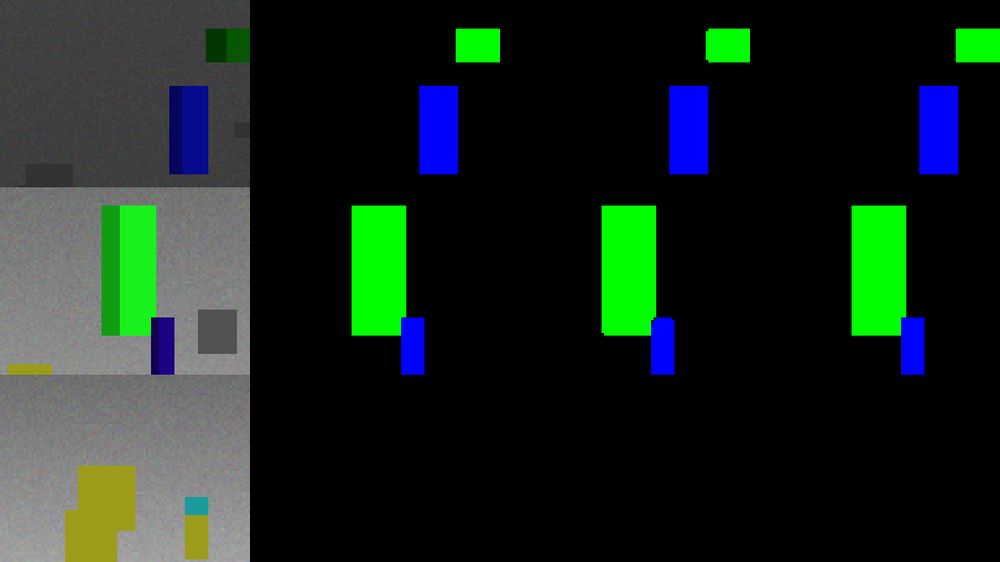
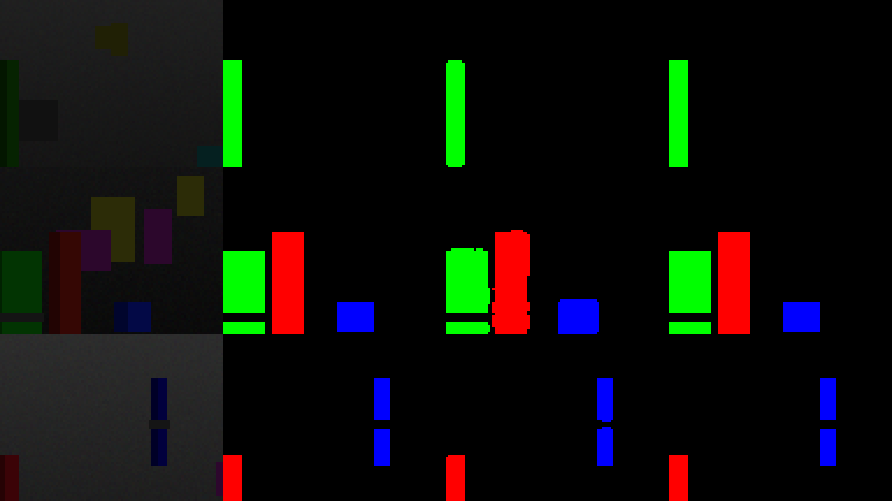
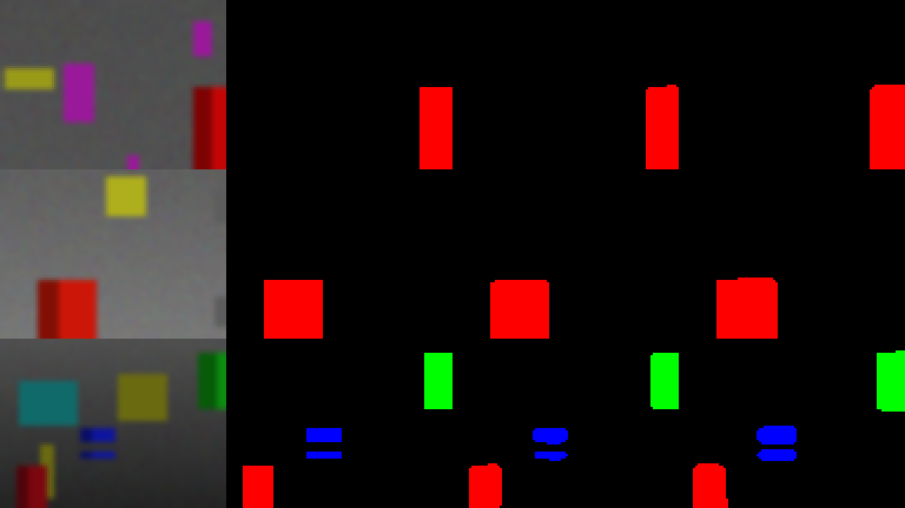
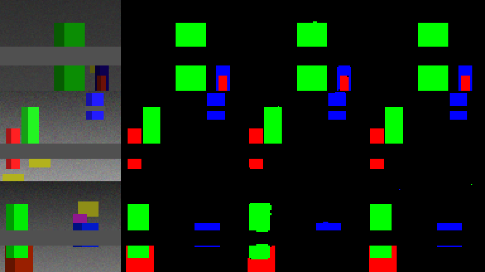
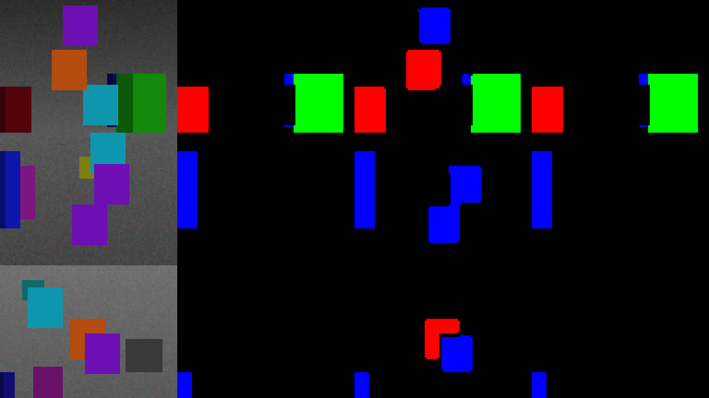
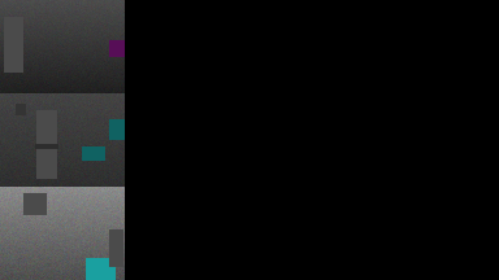

# CNN and HSV Image Comparison

This test compares the 1,460-parameter CNN with an HSV detector on 3,600 new synthetic images. HSV thresholds were chosen on separate calibration scenes; the CNN weights stayed fixed. Both detectors use the same images, target classes, and component filters.

| Synthetic case | Images | CNN macro IoU | HSV macro IoU | CNN median / p95 ms | HSV median / p95 ms |
| --- | ---: | ---: | ---: | ---: | ---: |
| standard | 600 | 98.08% | 99.76% | 1.267 / 2.518 | 0.143 / 0.283 |
| dim | 600 | 97.17% | 96.54% | 1.295 / 2.872 | 0.141 / 0.260 |
| blur | 600 | 93.38% | 91.34% | 1.346 / 4.206 | 0.146 / 0.329 |
| occlusion | 600 | 97.45% | 99.71% | 1.332 / 3.058 | 0.148 / 0.305 |
| near_color | 600 | 60.30% | 99.71% | 1.196 / 2.003 | 0.135 / 0.230 |
| missing | 600 | - | 0.00% | 1.138 / 2.015 | 0.120 / 0.200 |

## Detection errors

| Case | Method | Misses / positive class-images | False detections / negative class-images |
| --- | --- | ---: | ---: |
| standard | CNN | 65 / 1325 | 0 / 475 |
| standard | HSV | 67 / 1325 | 0 / 475 |
| dim | CNN | 44 / 1320 | 0 / 480 |
| dim | HSV | 49 / 1320 | 0 / 480 |
| blur | CNN | 61 / 1338 | 0 / 462 |
| blur | HSV | 49 / 1338 | 0 / 462 |
| occlusion | CNN | 127 / 1353 | 0 / 447 |
| occlusion | HSV | 132 / 1353 | 0 / 447 |
| near_color | CNN | 37 / 1340 | 219 / 460 |
| near_color | HSV | 73 / 1340 | 0 / 460 |
| missing | CNN | 0 / 0 | 0 / 1800 |
| missing | HSV | 0 / 0 | 0 / 1800 |

## Protocol and limits

- Audit seeds differ from recorded training, validation, legacy test, and HSV calibration seeds. The checkpoint and CNN threshold (0.65) remain unchanged.
- The script saves the full configuration and hashes before scoring audit data. HSV S/V thresholds are selected from 12 candidates using calibration only.
- IoU pools intersection/union by foreground class before component filtering, then averages classes with nonzero union. Missing-target IoU is undefined when neither method predicts pixels; detection false positives are the useful measure.
- Detection counts use the actual deployed component and aspect-ratio filters. A positive image has any visible ground-truth class pixel. Centroid error excludes missed detections and truth rejected by the component filter; report it with miss counts.
- Latency covers one selected-class detector call including resizing, inference, thresholding, and component filtering. It excludes loading, camera acquisition, BGRA conversion, control, and telemetry. Thirty warmup calls per detector are excluded; two PyTorch CPU threads are used.
- 95% paired bootstrap intervals in JSON resample synthetic scenes, retaining the three classes together. They describe this generated sample and do not establish real-world reliability.
- Dim uses a 0.35 brightness multiplier; blur uses a 5x5 Gaussian with sigma 1.2; occlusion overwrites 8-16 rows and their visible-pixel labels; near-color adds orange/cyan/purple background rectangles; missing removes all trained classes.
- Blur labels represent underlying visible geometry, so blurred boundaries can lower IoU. Near-color labels test semantic color boundaries absent from training; these are a deliberate distribution shift.
- No real-camera or physical-robot performance is claimed. No model retraining or audit-driven parameter tuning is performed.

Example columns: RGB image, visible-pixel ground truth, CNN masks, HSV masks. Red/blue/green overlays represent the respective catalog classes.

