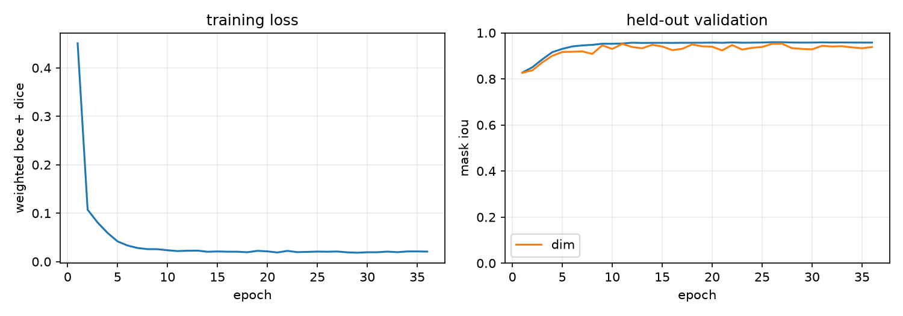
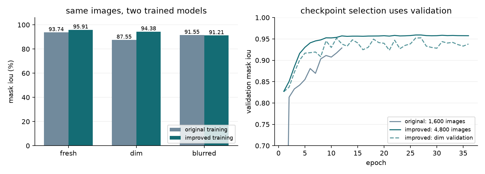

# results

## training

- 4800 training images, 320 validation images, 320 test images
- 1113 parameters, 36 epochs
- reused legacy synthetic test mask iou (diagnostic): 0.9550
- hsv mask iou on the same synthetic images: 0.5829

## model comparison

both models use the exact same images and a fixed 0.65 threshold. these audit
seeds were reserved before v3 training. dim images are scaled by 0.65; blurred
images use a 3 x 3 gaussian kernel with sigma 0.8. the sets have different scenes.

| case | images | original mask iou | v3 mask iou | gain (percentage points) |
| --- | ---: | ---: | ---: | ---: |
| fresh | 1000 | 0.9374 | 0.9591 | +2.17 |
| dim | 320 | 0.8755 | 0.9438 | +6.83 |
| blurred | 320 | 0.9155 | 0.9121 | -0.34 |

v2 improved normal-light masks but lost dim-light accuracy. that audit became
development data when it informed brightness augmentation. v3 fixes dim-light
performance against the original on the new set, but blur is still slightly worse.
the earlier reports are in `experiments`. these are synthetic masks, not real-world
accuracy or statistical reliability estimates.

## webots runs

each row is one deterministic 40-second simulation, not a statistical reliability estimate.
the moving target travels for five seconds, then holds still. in the occlusion scene
the target is moved out of view from seconds four through seven. the obstacle scene
puts a gray box between the robot and target. arrival requires a proximity stop
within 8 cm of the target surface. empty arrival means the task was not completed.

| scene | mode | arrival (sim s) | min target gap (m) | median perception (ms) | forward during occlusion (rad/s) |
| --- | --- | ---: | ---: | ---: | ---: |
| center | original | 31.424 | 0.0105 | 0.301 | - |
| center | hsv | 7.520 | 0.0167 | 0.597 | - |
| center | neural | 7.520 | 0.0163 | 1.259 | - |
| offset | original | 33.024 | 0.0126 | 0.300 | - |
| offset | hsv | 8.544 | 0.0190 | 0.610 | - |
| offset | neural | 8.416 | 0.0194 | 1.242 | - |
| moving | original | 32.064 | 0.0119 | 0.300 | - |
| moving | hsv | 7.872 | 0.0180 | 0.623 | - |
| moving | neural | 7.872 | 0.0179 | 1.315 | - |
| occlusion | original | 32.320 | 0.0106 | 0.302 | 0.50000 |
| occlusion | hsv | 10.848 | 0.0163 | 0.618 | 0.00000 |
| occlusion | neural | 10.688 | 0.0164 | 1.205 | 0.00000 |
| obstacle | original | incomplete | 0.1738 | 0.301 | - |
| obstacle | hsv | incomplete | 0.3229 | 0.503 | - |
| obstacle | neural | incomplete | 0.3229 | 1.071 | - |

a negative gap means the approximate circle/box geometry overlaps. it is a
failure signal, not a successful safety result. the gap is an approximation of
the robot body and does not measure every wheel or protrusion.

arrival improvements combine changes to speed and control. they are not evidence
that the neural model alone makes the robot faster. hsv reference agreement is
a consistency check, not ground-truth segmentation accuracy on webots frames.

the obstacle scene can fully hide the target. staying stopped is useful but
doesnt count as completing the route. this controller does not do obstacle avoidance.
