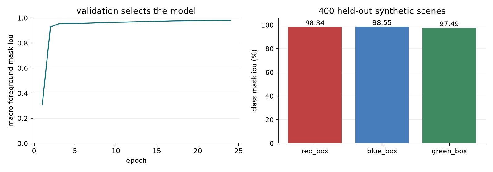
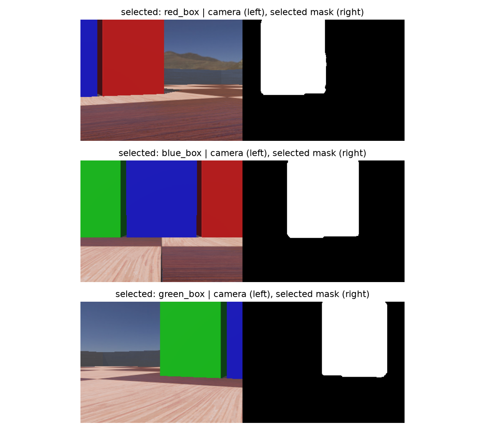

# Named target results

The catalog model has 1,460 parameters and was trained from random weights on
3,000 labeled synthetic images for 24 epochs. 320 validation images selected
the checkpoint. The untouched 400-image test split was scored afterward.
This dataset differs from the red-only model audit; don't compare the scores
as an improvement on the same task.

| target class | test mask IoU | empty-mask misses | negative-image false positives |
| --- | ---: | ---: | ---: |
| red_box | 0.9834 | 2 | 0 |
| blue_box | 0.9855 | 0 | 0 |
| green_box | 0.9749 | 0 | 0 |

Macro foreground mask IoU: 0.9813. Pooled IoU is calculated
separately for each class, then averaged. Masks use a fixed 0.65 threshold before
component filtering. Empty-mask misses are positive images with no predicted
pixels. Negative false positives require at least 0.003 of image area.

## Selected-target simulation

Each row is one deterministic 40-second run with three fixed box positions.
The selected color varies; the other two stay visible as distractors. Missing
cases hide only the selected box. Arrival requires a proximity stop within
8 cm of the selected surface. Missing cases should not complete an arrival.

| scene | arrival (sim s) | approximate min selected-target gap (m) | max forward command (rad/s) | median perception (ms) |
| --- | ---: | ---: | ---: | ---: |
| select_red_box | 8.416 | 0.0195 | 2.19999 | 1.268 |
| missing_red_box | none | - | 0.00000 | 0.989 |
| select_blue_box | 7.584 | 0.0021 | 2.20000 | 1.173 |
| missing_blue_box | none | - | 0.00000 | 0.938 |
| select_green_box | 8.576 | 0.0039 | 2.20000 | 1.199 |
| missing_green_box | none | - | 0.00000 | 0.960 |

All six runs kept the requested target name in every telemetry packet. The
selection unit test also checks which box produces the predicted centroid.
The red-only HSV reference fields in raw telemetry are not selected-target
accuracy measurements for blue or green. They are not used for steering.

There were no negative approximate selected-target gaps in these three approach
runs. The blue and green gaps were small (2.1 and 3.9 mm). Raw proximity readings
vary with the scene; this is not a verified physical stopping margin. Geometry
approximates the robot body and does not cover every wheel or protrusion.
Missing-target travelled distance was about 0.1 mm of simulator settling while
forward commands stayed zero. This does not measure general collision avoidance.
Same-class instances, more lighting conditions and real data need separate tests.
